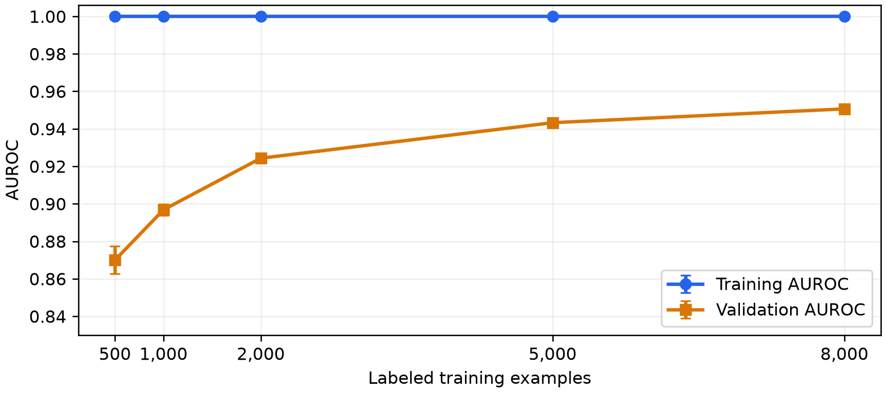

# Person B: completed Q2 and Q3

**Primary work:** Aarushi's experiments in team commit `0e09450`. **Completion:** Yuchen Feng (`yf467`) extended the existing code, filled missing rubric items, checked results and prepared this report. The original experiments retain Aarushi's attribution.

## Q2.1 — fixed configuration and required results

We extended Aarushi's existing TF-IDF logistic regression study, keeping C=4, at most 2,000 iterations, the shared 8,000/2,000 split, stratified subsampling and seeds 0, 1 and 2. We added the required 5,000-row point and training AUROC. Values below are means across three subsets, except the complete 8,000-row pool, which is fitted once. Each vocabulary and IDF is fitted on its own training subset only. The submitted style-model curves remain supplementary reference results.

| Training rows | Mean training AUROC | Mean validation AUROC | Validation sample SD | Fits |
|---:|---:|---:|---:|---:|
| 500 | 1.000000 | 0.869945 | 0.007346 | 3 |
| 1,000 | 1.000000 | 0.896831 | 0.002939 | 3 |
| 2,000 | 1.000000 | 0.924322 | 0.001391 | 3 |
| 5,000 | 1.000000 | 0.943272 | 0.001155 | 3 |
| 8,000 | 1.000000 | 0.950644 | 0.000000 | 1 |

The full-pool training value before rounding is 0.999999875. SD reflects the three subsampling seeds, not uncertainty across validation sets. At 8,000 rows the displayed zero SD indicates only one distinct fit, not measured zero uncertainty. Source: `../results/learning_curve_required.csv`; all runs and unchanged original style points: `../results/learning_curve.csv`.

## Q2.2 — training and validation learning curves

The required five-point plot is `../results/learning_curve_train_val.png`. Aarushi's two-model validation plot is retained and extended in `../results/learning_curve.png`. The original 32 validation points are preserved; only three TF-IDF 5,000-row fits are added. Training AUROC is available for the TF-IDF fits; original style-model training values are left unavailable rather than paired with a different local run.

## Q2.3 — discussion (115 words)

Training AUROC remains essentially 1.0000 across all five training sizes, while mean validation AUROC increases from 0.8699 with 500 examples to 0.9506 with 8,000. This persistent gap suggests overfitting rather than clear underfitting. More labeled data reduces the gap and improves generalization on the fixed validation set. Gains diminish: increasing from 500 to 1,000 examples adds about 0.0269 AUROC, whereas adding 3,000 examples between 5,000 and 8,000 adds about 0.0074. Variation across the three sampling seeds is larger at small sizes. At 8,000, all seeds would use the same complete pool, so only one fit is reported. The trend supports more labels but does not establish performance beyond 8,000 or guarantee robustness under distribution shift.

## Q3.1 — method and validation isolation (94 words)

We used Aarushi's teacher-student pseudo-labeling method. A gradient boosting teacher on stylometric features and a TF-IDF logistic regression control were trained on the same 8,000 labeled examples. The teacher assigned labels to unlabeled passages when p(AI) was at least 0.95 or at most 0.05, retaining 2,612 examples. We then refitted the entire TF-IDF student, including vocabulary and IDF, on the augmented training set. Both models were scored on the unchanged 2,000-example validation set. Validation labels never entered fitting or pseudo-label generation. Three thresholds were explored on this fold; selecting 0.95 therefore provides exploratory evidence.

## Q3.2 — primary submitted comparison

| Method | Labeled training rows | Pseudo-labeled rows | Validation AUROC |
|---|---:|---:|---:|
| Supervised TF-IDF LR (Aarushi) | 8,000 | 0 | 0.9506 |
| Style-teacher pseudo-labeling (Aarushi, threshold 0.95) | 8,000 | 2,612 | 0.9537 |

Source: Aarushi's unchanged `../results/pseudo_label.csv`; the two report rows are also in `../results/pseudo_label_report.csv`. Scores in the submitted table are available to four decimals; no extra precision is invented. The full six teacher/threshold combinations remain visible in the original table. Student TF-IDF is refitted on augmented texts; this is different from the earlier fixed-feature supplementary experiment.

## Q3.3 — discussion (98 words)

Aarushi's style-teacher run improved validation AUROC from 0.9506 to 0.9537, approximately 0.0031. Self-training did not improve the control. A teacher with different features may contribute information the TF-IDF student misses. However, confidence does not guarantee correct labels, and the style model is sensitive to formatting artifacts. This setting was selected after comparing two teachers and three thresholds on the same validation fold, so its gain is exploratory. Our local repetition gave the same improvement direction but different style scores. We retain the original results as primary evidence and report the repetition separately, without claiming a statistically reliable benefit.

## Local replication and reproducibility

The teacher-linked official files and original shared split passed SHA256 checks before and after fitting. No split was regenerated, no validation texts/labels entered model fitting, no hidden labels were used, and no Kaggle submission was made. Commands are in `../PERSON_B_RUNBOOK.md`.

All original TF-IDF learning-curve points reproduced exactly. A full local repetition of both learning-curve models and all seven pseudo-label rows is preserved in `../results/person_b_team_recheck/`. The style teacher at 0.95 selected 2,609 rows locally and achieved 0.954365 versus 0.950644. This differs from Aarushi's 2,612 / 0.9537 and is not substituted into her table. The cause of the small style differences was not isolated; her exact original environment was not recorded. Both observations are exploratory evaluations on the same validation fold.

Earlier seed-42 nested-subset and fixed-feature self-training results under `../results/person_b/` are supplementary historical experiments, not the primary report above. Their real scores and failed-check history are retained. The chosen primary Q2 now uses Aarushi's three seeds; do not mix its means with the earlier single-seed values.

## Contributions

Aarushi supplied the original model, sampling protocol, style features, teacher-student study and reference results. Yuchen's completion adds the required 5,000-row TF-IDF experiment, training scores, the train/validation plot, report responses, shared-split tracking and reproducibility material.

Overleaf has not been edited. This package provides the completed Person B text/figures for later insertion; the full team report, final model, course PR and final Kaggle selection remain group tasks.
